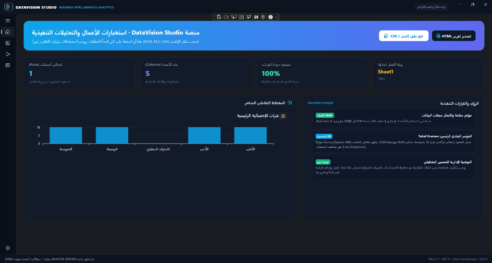

<div align="center">


# DataVision Studio
### Enterprise Business Intelligence & Advanced Multi-Engine Analytics
**المنصة التنفيذية لتحليل البيانات واستخبارات الأعمال لملفات الإكسل والجداول**

[](https://github.com/ebrahim-alazzani/DataVisionAI)
[](https://dotnet.microsoft.com/)
[](https://python.org/)
[](https://github.com/ebrahim-alazzani/DataVisionAI)
[](https://github.com/ebrahim-alazzani)
[](LICENSE)

<br/>

### 📸 لقطة حية من داخل التطبيق أثناء التشغيل (Live Application Screenshot):


</div>

---

## 📌 نظرة عامة (Overview)

**DataVision Studio** هو نظام سطح مكتب تنفيذي واحترافي لتحليل واستخبارات الأعمال مبني بواجهة **WinUI 3 (.NET 9 + Windows App SDK)**. صُمم التطبيق ليعمل كبديل محلي مستقل للأنظمة السحابية المعقدة، ويتيح للشركات والمحللين الماليين استيراد ملفات الإكسل (`.xlsx` متعددة الأوراق) وملفات `.csv` الضخمة، وتشغيل تحليلات إحصائية دقيقة، ومصفوفات ارتباط، ونماذج تعلم آلي تنبؤية محلياً 100% دون تسريب أي بيانات.

---

## ⚙️ المعمارية الثلاثية للتحليل (Triple-Engine Architecture)

يعتمد التطبيق على **3 محركات تحليل متكاملة** تضمن أقصى سرعة ودقة:

```
┌────────────────────────────────────────────────────────────────────────┐
│                          DataVision Studio                             │
└───────────────────────────────────┬────────────────────────────────────┘
                                    │
         ┌──────────────────────────┼──────────────────────────┐
         ▼                          ▼                          ▼
┌──────────────────┐      ┌──────────────────┐      ┌──────────────────┐
│     المحرك 1      │      │     المحرك 2      │      │     المحرك 3      │
│  C# Native Stats │      │ Python Data Sci  │      │ Machine Learning │
│  (خوارزمي محلي)   │      │ (Pandas & NumPy) │      │ (Scikit-Learn ML)│
└──────────────────┘      └──────────────────┘      └──────────────────┘
```

### 1. الطريقة الأولى: المحرك الإحصائي والخوارزمي الأصلي (C# Native 100% Offline):
* **بدون أي متطلبات خارجية:** يعمل فورياً وبسرعة البرق حتى على الأجهزة التي لا تحتوي على بايثون أو برامج أوفيس.
* **الإحصاء الوصفي الدقيق:** المجموع ($Sum$)، المتوسط الحسابي ($Mean$)، الوسيط ($Median$)، الانحراف المعياري ($\sigma$)، والتباين ($\sigma^2$).
* **كاشف القيم الشاذة الصارم (Tukey's IQR Outlier Test):**
  $$\text{Lower Fence} = Q_1 - 1.5 \times IQR \qquad \text{Upper Fence} = Q_3 + 1.5 \times IQR$$
* **مؤشر جودة واكتمال البيانات:** احتساب فوري لنسب الفراغ واكتمال كل عمود في الشيت.

### 2. الطريقة الثانية: محرك بايثون العلمي (Python Data Science Engine):
* يعتمد على مكتبات **Pandas** و **NumPy**.
* **مصفوفة الارتباط (Pearson Correlation Matrix):** حساب معاملات الارتباط بين كافة الأعمدة الرقمية وتحديد أقوى العلاقات الإحصائية المتبادلة (مثال: الارتباط بين مدة الاشتراك وإجمالي الإنفاق).
* استخراج التوزيعات التكرارية والـ Group-by Pivots.

### 3. الطريقة الثالثة: نموذج التعلم الآلي والتنبؤ (Machine Learning Predictive Model):
* يعتمد على مكتبة **Scikit-Learn**.
* **نموذج الانحدار الخطي والتنبؤ بالاتجاهات (Linear Regression & Forecasting):** تدريب نموذج آلي على البيانات التاريخية وتوقع القيم المستقبلية للفترات التالية مع حساب معامل التحديد ($R^2$).
* **التجميع العنقودي غير الخاضع للإشراف (K-Means Clustering):** تصنيف السجلات تلقائياً إلى مجموعات وشرائح متماثلة السلوك والخصائص.

---

## 📊 لوحة المؤشرات والمخططات التفاعلية المزدوجة (Power BI Style)

* **مخططات تفاعلية مزدوجة (Multi-Visual Grid):**
  * **مخطط الأعمدة التفاعلي (Bar Chart):** لمقارنة الفئات والأقسام الأكثر تحقيقاً للمبيعات أو الأرقام.
  * **مخطط دائري مجوف (Donut Chart):** لحساب الحصص السوقية والنسب المئوية لكل فئة.
* **الاستعلام الإحصائي السريع:** فحص فوري للأعمدة، أو القيم الشاذة، أو الملخص التنفيذي بنقرة زر واحدة.
* **تصدير التقارير الإدارية:** توليد تقرير تنفيذي كامل بصيغة HTML جاهز للطباعة أو التقديم للإدارة.

---

## 📁 ملفات بيانات واقعية متكاملة مرفقة للاختبار (Sample Datasets)

لتجربة كامل قدرات النظام والمخططات متعددة الأبعاد، تم تضمين حزمة بيانات واقعية في مجلد `samples/`:

| الملف | الوصف والحجم | الميزات التي يختبرها |
|---|---|---|
| `samples/enterprise_sales_inventory.xlsx` | **ملف إكسل متكامل بـ 3 أوراق عمل** (المبيعات، المخزون، تقييم الأداء) | اختبار تبديل أوراق العمل، المخططات المزدوجة، توزيع الفروع |
| `samples/bakery_production_arabic.csv` | **بيانات إنتاج المخابز والتكاليف بالعربي** (~500 KB) | اختبار استيعاب النصوص العربية الكبيرة واكتشاف الهدر |
| `samples/customer_churn_analysis.csv` | **بيانات 5,000 عميل لشركة اتصالات** (~700 KB) | اختبار مصفوفة الارتباط ونموذج التعلم الآلي والتنبؤ بالإنفاق |
| `samples/california_market_housing.csv` | **أكثر من 20,000 سجل عقاري** (~1.4 MB) | اختبار السرعة القصوى وقدرة التحمل للأحجام الكبيرة |

> 💡 **ملاحظة:** ملف `MASTER_REPORT.csv` الذي ظهر في لقطة الشاشة الأولى كان يحتوي على صف واحد فقط، بينما عند فتح ملفات `samples/` أعلاه ستشاهد كامل قدرات المخططات المزدوجة ومصفوفات الارتباط وتنبؤات التعلم الآلي.

---

## 🛠️ كيفية التشغيل والبناء (How to Run & Build)

> 💡 **ملاحظة:** جميع الأوامر والملفات تعتمد على **مسارات نسبية (Relative Paths)** وتعمل فوراً على أي جهاز أو مجلد دون أي تعديل.

### 1. التشغيل السريع بنقرة واحدة:
شغّل الملف المباشر:
```cmd
run_datavision.bat
```

### 2. التشغيل عبر سطر الأوامر:
```powershell
cd src/DataVision.Desktop
dotnet run -p:Platform=x64
```

### 3. بناء نسخة تشغيل نهائية مستقلة (Publish Standalone EXE):
لإنشاء ملف `.exe` تنفيذي مستقل يعمل على أي جهاز دون الحاجة لتثبيت .NET SDK:
```cmd
build_release.bat
```
أو عبر الأمر:
```powershell
dotnet publish src/DataVision.Desktop/DataVision.Desktop.csproj -c Release -r win-x64 --self-contained true -p:WindowsPackageType=None -o ./publish
```

---

## 📐 المعمارية البرمجية ومبادئ SOLID (Clean Architecture)

تم تنظيم الكود البرمجي وفق معايير SOLID و Clean Architecture:
* **`Core/Interfaces/`**: عقود واجهات منفصلة (`IExcelReaderService`, `IAnalyticsEngineService`, `IPythonAnalyticsService`, `IChartGeneratorService`, `IReportExportService`).
* **`Services/`**: التنفيذ الفعلي للخوارزميات ومحركات التحليل وتوليد ملفات الـ HTML والـ Markdown.
* **`ViewModels/`**: إدارة الحالة ونماذج العرض باستخدام `CommunityToolkit.Mvvm`.
* **`Views/`**: واجهات XAML بتصميم مايكروسوفت الحديث (Windows 11 Fluent Design).

---

## 👨‍💻 المطور وبيانات التواصل (Developer & Credits)

<div align="right">

* **المطور الرئيسي:** إبراهيم العزاني (**Ebrahim Al-Azzani**)
* **المشروع:** DataVision Studio · Enterprise Business Intelligence Platform
* **المستودع الرسمي:** [https://github.com/ebrahim-alazzani/DataVisionAI](https://github.com/ebrahim-alazzani/DataVisionAI)
* **الترخيص:** مرخص بموجب رخصة [MIT License](LICENSE).

</div>
