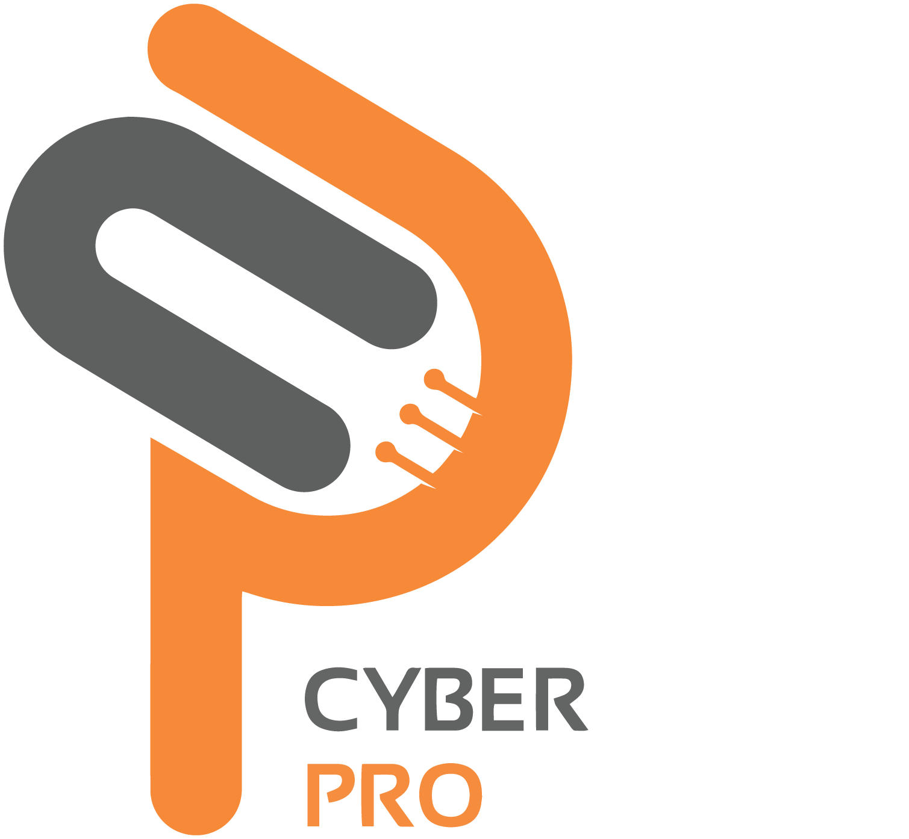
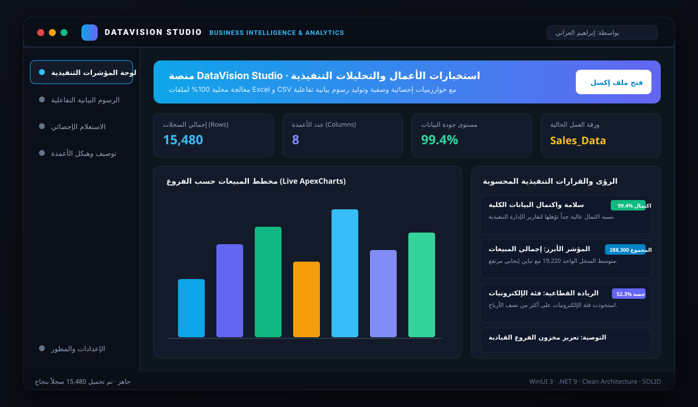

<div align="center">



# DataVision Studio
### Enterprise Business Intelligence & Advanced Statistical Analytics Desktop Suite
**منصة استخبارات الأعمال والتحليلات الإحصائية المتقدمة لملفات الإكسل والجداول**

[](https://github.com/ebrahim-alazzani/DataVisionAI)
[](https://dotnet.microsoft.com/)
[](https://github.com/ebrahim-alazzani/DataVisionAI)
[](https://github.com/ebrahim-alazzani)
[](LICENSE)

<br/>



</div>

---

## 📌 نظرة عامة (Overview)

**DataVision Studio** هو نظام سطح مكتب تنفيذي متكامل مبني بأحدث تقنيات مايكروسوفت **WinUI 3 (.NET 9 + Windows App SDK)**، صُمم خصيصاً للمؤسسات والشركات والمحللين الماليين لاستيراد وفحص وتحليل ملفات البيانات الضخمة (`.xlsx` و `.csv`)، وتوليد مؤشرات الأداء الرئيسية (KPIs)، والمخططات التفاعلية، والتقارير التنفيذية الصالحة للطباعة **بشكل محلي 100% دون إرسال أي بايت خارج جهازك**.

> 🔒 **لماذا محرك إحصائي خوارزمي محلي 100% وبدون اعتمادات خارجية؟**
> - **سرية تامة للبيانات:** ملفات الرواتب، والمبيعات، والحسابات البنكية تظل مشفرة ومخزنة في ذاكرة جهازك فقط.
> - **دقة حسابية صارمة (Zero Hallucination):** الحسابات الرياضية مبنية على نظريات إحصائية مثبتة (IQR, Tukey Fences, Variance, Standard Deviation, Percentiles) دون أي أخطاء أو تخمينات.
> - **مجاني ومستقل مدى الحياة:** يعمل في أي بيئة دون الحاجة لاشتراكات سحابية، أو مفاتيح API، أو حتى اتصال بالإنترنت.

---

## 🚀 المميزات الأساسية (Core Features)

1. **معالج الجداول فائق السرعة (Zero-Dependency Spreadsheet Engine):**
   * قراءة ملفات Excel الحديثة (`.xlsx`) والقديمة وملفات `.csv` الكبيرة مباشرة عبر مكتبات OpenXML دون الحاجة لتثبيت Microsoft Office.
   * دعم كامل وأصيل للترميز العربي (`UTF-8` و `Windows-1256`).
2. **محرك الإحصاء الوصفي الشامل (Descriptive Statistics Engine):**
   * احتساب: المجموع ($Sum$)، المتوسط الحسابي ($Mean$), الوسيط ($Median$), التباين ($\sigma^2$), الانحراف المعياري ($\sigma$).
   * احتساب الربيعيات: $Q_1$ (مئوية 25%), $Q_3$ (مئوية 75%), والمدى الربيعي ($IQR = Q_3 - Q_1$).
3. **كاشف القيم الشاذة الآلي (Automated Anomaly & Outlier Detector):**
   * كشف السجلات المتطرفة باستخدام قاعدة توكي الصارمة ($Tukey's\ Fence$):
     $$\text{Outliers} = x < (Q_1 - 1.5 \times IQR) \quad \text{أو} \quad x > (Q_3 + 1.5 \times IQR)$$
4. **استوديو المخططات التفاعلية المباشرة (ApexCharts Studio):**
   * عرض فوري وسلس للمخططات: أعمدة (Bar)، خطوط (Line)، مساحي (Area)، ودائري مجوف (Donut).
   * تكبير، تقريب، فحص النطاقات الزمنية، وتصدير الرسوم بجودة متناهية الدقة.
5. **وحدة الاستعلام والفحص التنفيذي (Statistical Query Console):**
   * طرح استفسارات إحصائية مباشرة للحصول على كشف سريع بالأعمدة، ونسب الاكتمال، وترتيب الفئات القيادية (Pareto 80/20).
6. **مُصدّر التقارير التنفيذية (Executive Report Exporter):**
   * تصدير فوري بنقرة زر لتقارير إدارية كاملة بصيغتي **HTML تفاعلي** و **Markdown**.

---

## 📐 المعمارية الهندسية وأنماط التصميم (Clean Architecture & SOLID)

تم بناء المشروع بالكامل وفق أفضل الممارسات الهندسية المعترف بها عالمياً:

```
src/DataVision.Desktop/
├── Core/                               # [Domain Layer] النواة البرمجية الصافية
│   ├── Interfaces/                     # عقود وفصول الخدمات (Abstraction Contracts)
│   │   ├── IExcelReaderService.cs      # عقد قارئ الجداول
│   │   ├── IAnalyticsEngineService.cs  # عقد محرك الإحصاء والتحليلات
│   │   ├── IChartGeneratorService.cs   # عقد مولد الرسوم البيانية
│   │   └── IReportExportService.cs     # عقد تصدير التقارير
│   └── Enums/                          # التعدادات القياسية للبيانات والمخططات
├── Models/                             # [Data Models] كائنات التوصيف الإحصائي
│   ├── DataColumnProfile.cs            # توصيف إحصائي للعمود (Mean, Median, IQR...)
│   ├── DataTableProfile.cs             # بيانات الجدول ككل وجودة البيانات الكلية
│   └── ExecutiveInsight.cs             # الرؤية التنفيذية المحسوبة
├── Services/                           # [Infrastructure Layer] التنفيذ الفعلي للعقود
│   ├── ExcelReaderService.cs           # معالج ملفات XLSX و CSV
│   ├── StatisticalAnalyticsService.cs  # خوارزميات الإحصاء واكتشاف القيم الشاذة
│   ├── ChartGeneratorService.cs        # مولد مواصفات ApexCharts
│   ├── ReportExportService.cs          # مولد وثائق HTML و Markdown
│   └── NativeFileDialog.cs             # نافذة اختيار الملفات الأصلية المستقرة (Win32)
├── ViewModels/                         # [Application / Presentation State]
│   ├── MainViewModel.cs                # نموذج العرض الرئيسي وحالة التطبيق
│   └── AnalyticsSummaryViewModel.cs    # نموذج عرض وحدة الاستعلام
├── Views/                              # [UI Layer] صفحات XAML لواجهة WinUI 3
│   ├── MainWindow.xaml                 # الإطار الرئيسي وشريط التنقل الجانبي
│   ├── DashboardPage.xaml              # لوحة القيادة والمؤشرات التنفيذية
│   ├── ChartsPage.xaml                 # استوديو المخططات التفاعلية
│   ├── AnalyticsSummaryPage.xaml       # وحدة الاستعلام الإحصائي
│   ├── DataPreviewPage.xaml            # استعراض الأعمدة ومقاييس البيانات
│   └── SettingsPage.xaml               # الإعدادات، ومعايير المعمارية، والمطور
└── Assets/                             # شعارات وأيقونات التطبيق
```

### تطبيق مبادئ SOLID عملياً في الكود:
* **S (Single Responsibility Principle):** كل فئة (`Class`) مسؤولة عن وظيفة محددة بدقة؛ قارئ الإكسل لا يعلم شيئاً عن الرسوم البيانية، ومولد التقارير لا يتدخل في حساب الإحصائيات.
* **O (Open/Closed Principle):** محرك الإحصاء والتحليلات مهيأ لإضافة مقاييس وخوارزميات جديدة دون تعديل واجهات الاستدعاء الأساسية.
* **L (Liskov Substitution Principle):** يمكن استبدال أي خدمة من خدمات النواة بأي تطبيق آخر يحقق نفس الـ Interface دون كسر الواجهة.
* **I (Interface Segregation Principle):** الواجهات مقسمة لعقود صغيرة ومحددة الهدف (`IExcelReaderService`, `IChartGeneratorService`, `IReportExportService`).
* **D (Dependency Inversion Principle):** جميع الـ ViewModels تعتمد حصراً على واجهات التجريد (`Interfaces`) ويتم حقنها آلياً عبر حاوية حقن التبعيات (`Microsoft.Extensions.DependencyInjection`).

---

## 💻 متطلبات التشغيل والتثبيت (Requirements)

* **نظام التشغيل:** Windows 10 (إصدار 1809 وما بعده) أو Windows 11.
* **بيئة التشغيل:** .NET SDK 9.0 (للراغبين في تشغيل الكود المصدري) أو بدون أي متطلبات للنسخة المجمعة مسبقاً (Self-Contained Executable).

---

## 🛠️ كيفية التشغيل والبناء (How to Run & Build)

> 💡 **ملاحظة:** جميع الأوامر والملفات تعتمد على **مسارات نسبية (Relative Paths)** وتعمل فوراً على أي جهاز أو مجلد يتم نسخ المستودع إليه دون أي تعديل.

### 1. التشغيل السريع بنقرة واحدة (1-Click Run):
انقر نقراً مزدوجاً على الملف:
```cmd
run_datavision.bat
```

### 2. التشغيل عبر سطر الأوامر (Command Line):
```powershell
# 1. استنساخ المستودع
git clone https://github.com/ebrahim-alazzani/DataVisionAI.git
cd DataVisionAI

# 2. تشغيل التطبيق
cd src/DataVision.Desktop
dotnet run -p:Platform=x64
```

### 3. بناء نسخة تشغيل نهائية مستقلة (Publish Standalone EXE):
إذا أردت إنشاء ملف تنفيذي مستقل `.exe` لا يحتاج تثبيت .NET أو Visual Studio على أي كمبيوتر آخر:
* شغّل ملف البناء المباشر:
  ```cmd
  build_release.bat
  ```
* أو نفّذ الأمر التالي:
  ```powershell
  dotnet publish src/DataVision.Desktop/DataVision.Desktop.csproj -c Release -r win-x64 --self-contained true -p:WindowsPackageType=None -o ./publish
  ```
  ستجد الملف التنفيذي جاهزاً في المجلد: `publish/DataVision.Desktop.exe`.

---

## 📊 ملف بيانات تجريبي للاختبار الفوري

يحتوي المستودع على ملف مبيعات واقعي باللغتين العربية والإنجليزية جاهز لاختبار البرنامج فوراً:
* مسار الملف النسبي: `./sample_sales_data.csv`
* يتضمن حقول: (التاريخ، الفرع، فئة المنتج، الكمية المباعة، إجمالي المبيعات، صافي الأرباح، تقييم العملاء).

---

## 👨‍💻 المطور وبيانات التواصل (Developer & Credits)

<div align="right">

* **المطور الرئيسي:** إبراهيم العزاني (**Ebrahim Al-Azzani**)
* **المشروع:** DataVision Studio · Enterprise Business Intelligence Platform
* **المستودع الرسمي:** [https://github.com/ebrahim-alazzani/DataVisionAI](https://github.com/ebrahim-alazzani/DataVisionAI)
* **الترخيص:** مرخص بموجب رخصة [MIT License](LICENSE).

</div>

---

<div align="center">
  <sub>صُمم وطُوّر بكل فخر بواسطة إبراهيم العزاني باستخدام تقنيات مايكروسوفت الحديثة .NET 9 &amp; WinUI 3</sub>
</div>
